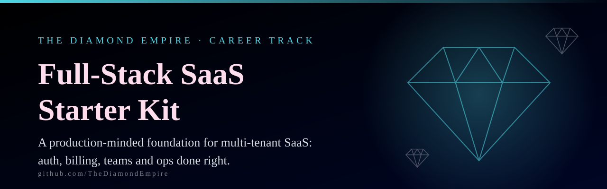
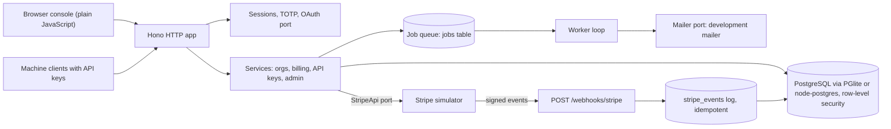

<p align="center"></p>

<p align="center">
  
  
  
</p>

# Full-Stack SaaS Starter Kit

> A production-minded foundation for multi-tenant SaaS: auth, billing, teams and ops done right.

A reference implementation of the undifferentiated 80% of a SaaS product: authentication, organizations, role-based access, subscription billing, transactional email, audit logging and deployment, built to the same standard you would hold a paid product to. Sold by **The Diamond Empire** (<https://thedempire.shop/>).

**Quick links:** [Architecture](#architecture) · [Tech stack](#tech-stack) · [Engineering decisions](#engineering-decisions) · [Roadmap](#roadmap) · [Quality report](docs/quality-report.md) · [Security checklist](docs/security-checklist.md) · [Case study](docs/case-study.md)

> **Public showcase.** This repository holds the documentation, client case study, research report and measured results for this product. The runnable source code is distributed separately under a license: see [SOURCE-ACCESS.md](SOURCE-ACCESS.md).

## At a glance

|  |  |
|---|---|
| **Track** | Career · Advanced |
| **Phase** | Beta: all five milestones are built and their tests pass from a clean short-path copy, with recorded results in the [quality report](docs/quality-report.md). Read the next section for what was not run: nothing has touched real PostgreSQL, Stripe, email or cloud infrastructure. |
| **Primary reader** | Hiring managers and engineering leads |
| **Read next** | [Quality report](docs/quality-report.md) · [Architecture](docs/architecture.md) · [Client case study](docs/case-study.md) |

## Read this first: what was and was not run

This starter was built on one Windows machine with **no PostgreSQL server, no Redis, no working Docker, no Terraform binary, no Stripe account and no email provider**. So:

- The database is **PGlite** (PostgreSQL 18 compiled to WebAssembly, running in-process). It is a real PostgreSQL engine with row-level security, roles, triggers and advisory locks, but it has one connection and is not a server. **Row-level security, tenant isolation and every other database behavior were never tested against a real PostgreSQL server.** A node-postgres adapter exists and was tested only against PGlite served over the PostgreSQL wire protocol.
- **Stripe was never called.** Billing runs on an in-process Stripe simulator that produces Stripe-shaped objects and events. Webhook signatures follow Stripe's documented scheme, but were only ever checked against this repository's own signer. A real Stripe client is **not built**: you implement the six-method `StripeApi` port before taking payments. Production start-up refuses to run on the simulator unless you acknowledge it.
- **No email provider was contacted.** Email goes through a development mailer that records messages in a table.
- **OAuth** runs against a fake in-process provider. No real provider is implemented.
- The **Dockerfile, compose file, Terraform and CI workflow were never built, applied or run.** The Terraform was only parsed as HCL syntax.
- The console was opened by hand in one browser during development; **no browser test and no accessibility tool was run**. Colour contrast of the console's colour tokens is computed by a script.

Every number in this repository comes from a script in it that was run; see the [quality report](docs/quality-report.md).

## Why this exists

Every SaaS starts by rebuilding the same plumbing, and the shortcuts taken there (weak tenancy, billing webhooks that double-charge, missing audit trails) become the expensive bugs of year two.

## What it does (built and tested)

- **Sign-in and sessions:** email and password sign-up with email verification, password reset, scrypt hashing, account lockout, opaque server-side sessions with idle and absolute expiry, session list and revocation, CSRF tokens. TOTP two-factor authentication verified against the RFC 6238 and RFC 4226 test vectors, with single-use recovery codes and replay protection. OAuth authorization-code sign-in with PKCE and state, against a fake provider, including protection against account pre-hijacking.
- **Organizations and access control:** organizations, invitations (hashed single-use tokens, matched to a verified email), four roles, a permission matrix with no privilege escalation, last-owner protection, tenant isolation enforced by PostgreSQL row-level security.
- **Billing on a simulator:** free, Pro and Business plans, trials, plan changes with proration, cancel at period end and resume, a past-due grace period, idempotent signed-webhook intake with an event log, tolerance for replayed, duplicated and out-of-order events, and an invoice history.
- **Usage metering and entitlements:** idempotent usage events, seat limits, project limits, plan features and monthly API quotas tied to the plan.
- **API keys, rate limits and audit:** scoped API keys (stored as hashes), a token-bucket rate limiter with plan-based limits, and an append-only, hash-chained audit log whose chain can be verified.
- **Operations:** a platform admin back office (admin role plus MFA required, every action audited), a durable job queue with retries and dead-lettering, transactional email through a mailer port, in-app notifications, feature flags with percentage rollout and overrides, health and readiness endpoints, structured logging with secret redaction, one-command local setup.
- **Delivery:** a Dockerfile, a compose file, an example Terraform deployment and a CI workflow, none of which were run (see above).

## Not built yet / out of scope

| Item | Why |
|---|---|
| Next.js, Tailwind CSS, Auth.js | Replaced by a small Hono server and a plain-JavaScript console: a Next.js build and browser test setup did not fit the shared build machine, and the priorities were the tenancy, billing, security and audit logic. See [ADR 0001](docs/adr/0001-http-framework.md). |
| Drizzle ORM | Plain SQL migrations with a checked tenancy declaration per table gave direct control of row-level security. See [ADR 0002](docs/adr/0002-sql-first.md). |
| Passkeys (WebAuthn) | Needs a browser and an authenticator to test. |
| A real Stripe client | No Stripe account; a real client could not be tested. The `StripeApi` port is the seam. |
| A real email provider (Postmark, Resend) | No account; only the `Mailer` port and a development mailer exist. |
| A real OAuth provider | Only the provider port and a fake provider exist. |
| Redis | The job queue and the rate limiter sit behind interfaces; the shipped implementations are a PostgreSQL table and in-process memory. A multi-instance deployment needs a shared rate-limit store. |
| Testcontainers, Playwright | No container runtime and no browser tests; the end-to-end suite runs over HTTP against the real application stack. |
| Impersonation in the back office | Deliberately left out. |
| Per-tenant data export, SSO/SAML, SCIM | Out of scope for this version. |
| Verified Terraform, Docker image, CI run | Never run (see above). |

## Architecture



More detail, including the tenancy model and the webhook flow, is in [docs/architecture.md](docs/architecture.md).

## Tech stack

What is actually used, against the blueprint's original choices:

| Layer | Used here | Blueprint |
|---|---|---|
| App | Hono (HTTP), TypeScript, a plain-JavaScript console with a system font stack | Next.js (App Router), Tailwind CSS |
| Auth | Own implementation on `node:crypto`: scrypt, opaque sessions, TOTP (RFC 6238), OAuth authorization code with PKCE (fake provider only) | Auth.js with passkeys and TOTP MFA |
| Data | PGlite (PostgreSQL 18 in WebAssembly) for development and tests, node-postgres adapter for a networked server (tested only against PGlite over the wire), plain SQL migrations, row-level security | PostgreSQL, Drizzle ORM, row-level security |
| Billing | In-process Stripe simulator behind a `StripeApi` port; Stripe's documented webhook signature scheme | Stripe Billing and webhooks (test mode) |
| Jobs and email | A durable job queue in a PostgreSQL table, a `Mailer` port with a development mailer | Redis queue, Postmark or Resend |
| Testing | Vitest, fast-check (property tests), an HCL parser for the Terraform syntax check | Vitest, Playwright, Testcontainers |
| Delivery | Dockerfile, compose file, Terraform (AWS ECS Fargate and RDS) and a GitHub Actions workflow: all written, none run | Docker Compose locally, Terraform and GitHub Actions |

## Engineering decisions

### Webhooks are an event log first

Stripe events are stored under their event id before they are processed. Effects and the "processed" mark commit in one transaction locked on the event row, so a crash rolls everything back and a retry or a concurrent duplicate cannot apply a change twice. Each subscription and invoice remembers the time of the last event applied to it, so a late, older event is recorded as stale instead of overwriting newer state. Known limit: event times have one-second resolution, so two events about one object in the same second can arrive in the wrong order and be applied in arrival order; a canceled subscription is never revived that way, and `reconcile()` re-reads a subscription from the Stripe API as the remedy. Experiment E2 measures this (see the quality report).

### Tenancy by default

Every tenant table carries an organization id protected by row-level security. Tenant code runs as an unprivileged database role with the tenant set per transaction; a missing context returns no rows. Each table declares its tenancy class in its migration, a linter refuses a table without one, and a test compares the declaration with the real catalog: a new table fails the suite until it is classified, protected and given a fixture. Privileges are granted table by table; nothing is granted by default. The few modules allowed to bypass row-level security are pinned by a test.

### Billing state changes in one place

Local subscription state is written only when a webhook arrives, never by the API call that asked for the change. One code path changes billing state, and tenants cannot write it at all (read-only grants).

### Zero-downtime migrations

A migration linter flags blocking operations (non-concurrent indexes on existing tables, new `NOT NULL` columns without a default, drops, renames, type changes, validating foreign keys) and asks for expand, migrate, contract. It is a text heuristic, not a SQL parser. The runner is transactional, so concurrent index builds are not supported by it.

More decisions are recorded as ADRs in [docs/adr/](docs/adr/).

## Quality bar

- End-to-end tests of the signup, subscribe, upgrade, use and cancel path over HTTP.
- A [security checklist](docs/security-checklist.md) that maps what was done to the application-security topics of OWASP ASVS Level 1, with what was tested and what was not. It is not a certification or a full audit.
- Dependency scanning (`npm audit` on the production tree and a license check) and secret scanning (a repository scan) recorded in `results/`.
- Architecture decision records for each major choice.

## Roadmap

- [x] M1: auth, organizations and RBAC
- [x] M2: Stripe subscriptions and webhook event log (simulated Stripe)
- [x] M3: API keys, rate limits and audit log
- [x] M4: admin back office and email (development mailer only)
- [x] M5: Terraform deploy and end-to-end test suite (the end-to-end suite is verified; the Terraform was only syntax-checked and never planned or applied)

Milestones are ticked when their code and tests pass; the caveats in brackets are part of the tick.

## Getting started

> _These instructions refer to the source package, which is distributed separately and is not part of this showcase repository._

Requires Node.js 24 or newer. These are the commands that were run, from a clean copy:

```bash
npm ci
npm run demo
```

`npm run demo` creates a PGlite data directory under `data/` (ignored by git), applies the migrations, seeds a small clearly fake demo tenant and starts the server on <http://localhost:3000>. The setup step prints the demo accounts and a random demo password. To run the pieces separately: `npm run setup`, then `npm start`. Delete `data/` to start over.

In the console, mail is recorded rather than sent: the sign-up confirmation link appears for a platform admin under Admin, Recorded email. To use the Admin tab, sign in as the demo platform admin, turn on two-factor authentication under Account and sign in again.

Networked PostgreSQL: set `DATABASE_URL` (see `.env.example`); the role that connects must be able to create the `app_user` role. Production: `npm run build`, then `npm run start:prod` with `NODE_ENV=production`, `SECRET_KEY`, `STRIPE_WEBHOOK_SECRET` and `DATABASE_URL`; start-up refuses weak or missing values and refuses the billing simulator unless `ALLOW_BILLING_SIMULATOR=1`.

## Verification

> _These instructions refer to the source package, which is distributed separately and is not part of this showcase repository._

```bash
npm run check          # typecheck, lint, format check, all tests
npm run scan:repo      # packaging contract: no local paths, no stray names, no secrets, README structure, links
npm run licenses       # license check over the lock file
npm run contrast       # contrast ratios of the console's colour tokens
npm run smoke:build    # build, start the compiled server on localhost, query it, stop it
npm run experiments    # E1 tenant-isolation fuzz, E2 webhook replay, E3 rate-limit accuracy (writes results/)
npm run measure -- --out <dir>   # the whole measurement set in one invocation, raw results into <dir>
npm run results:tables # rebuild the results tables in docs/quality-report.md from results/*.json
```

`npm run experiments:smoke` runs tiny versions of the experiments into `.tmp/`. The CI workflow in `.github/workflows/ci.yml` runs the same commands but **has never been executed**. Results, the commands that produced them, limits and a change log are in the [quality report](docs/quality-report.md).

## Repository layout

> _These instructions refer to the source package, which is distributed separately and is not part of this showcase repository._

```text
src/            the application: config, db (adapters, migrations), auth, orgs, billing, apikeys, audit, jobs, email,
                notifications, flags, admin, projects, ratelimit, http (routes), server (entry point), ui (console), testing (fixtures)
tests/          unit, property, integration, HTTP and end-to-end tests
experiments/    E1 to E3 and their runner
scripts/        setup, build, repository scan, license check, contrast, smoke run, test record, measure, results tables
deploy/         example Terraform (never applied)
docs/           architecture, quality report, security checklist, ADRs, case study
results/        raw measurement output (JSON) and a generated summary
```

## Skills demonstrated

`SaaS architecture` · `Payments and billing correctness` · `Application security` · `Database design and migrations` · `Test strategy` · `Developer experience`

## One project, three lenses

The same project is documented for three audiences, so one body of work serves every goal.

| If you are… | Read | You will find |
|---|---|---|
| Hiring or reviewing engineers | [This README](README.md) | Architecture, trade-offs, quality bar and what I would defend in a design review |
| A client or founder | [Client case study](docs/case-study.md) | The business problem, the value levers, how it is measured and how an engagement runs |
| A researcher or technical reviewer | Not applicable | This project is judged on its case study and its tests rather than an experimental study |

## Author

Built by **[The Diamond Empire](https://thedempire.shop/)**.
