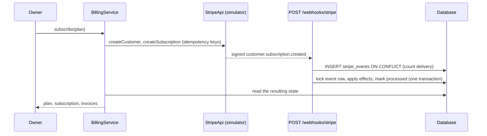

# Architecture

A guided tour of how the starter is put together and why. Everything described here exists in the code; what was not built is listed in the [README](../README.md#not-built-yet--out-of-scope). Seller: The Diamond Empire, <https://thedempire.shop/>.

## Layers

| Layer | Where | Rule |
|---|---|---|
| HTTP | `src/http/app.ts` | Parses and validates requests, resolves the caller (session cookie or API key), checks CSRF and rate limits, calls a service, shapes the response. No SQL. |
| Services | `src/*/service.ts` | Business rules. Each one receives its ports (`Deps`) and never reads global state. Time comes from an injected `Clock`. |
| Ports | `src/db/adapter.ts`, `src/billing/stripe.ts` (`StripeApi`), `src/email/mailer.ts` (`Mailer`), `src/auth/oauth.ts` (`OAuthProvider`), `src/ratelimit/ratelimit.ts` (`RateLimitStore`) | The seams where real infrastructure plugs in. |
| Adapters | `src/db/pglite.ts`, `src/db/postgres.ts`, `src/billing/fake-stripe.ts`, `DbMailer`, `FakeOAuthProvider`, `MemoryRateLimitStore` | What was actually built and run. Only the database has two adapters. |

## The two ways to touch the database

`Db.system(fn)` runs in one transaction as the owning role and bypasses row-level security. `Db.tenant({ orgId, userId }, fn)` runs in one transaction as the unprivileged role `app_user`, with `app.org_id` and `app.user_id` set as transaction-local settings. Row-level security policies compare each row with those settings; when a setting is empty the comparison is with NULL and matches nothing, so the policies fail closed.

Rules that keep this safe:

- The organization id given to `tenant()` comes from a membership lookup (`OrgService.resolveActor`), never from request input. A test documents that boundary.
- Only the modules that genuinely cannot have a membership yet use `system()`: sign-in and sessions, webhook intake, API-key lookup by prefix, organization creation, invitation acceptance, the admin back office, the job worker and the mailer. A test pins that list of files.
- Calls are never nested (the PGlite adapter has one connection and would wait for itself).

Every table declares a tenancy class in its migration:

| Class | Meaning | What the catalog test checks |
|---|---|---|
| `tenant` | Rows carry `org_id` | Row-level security on, every policy references `app.org_id()`, `org_id` is `uuid` and not null |
| `tenant_root` | The organizations table | As above, keyed by `id` |
| `user` | Rows belong to a user (the users table) | Row-level security on, a policy references `app.user_id()`; password hash and TOTP columns are not granted |
| `system` | Authentication, webhook log, sent mail | `app_user` holds no privilege at all |
| `outbox` | The job queue | `app_user` may insert, nothing else |
| `global` | Reference data (feature flag definitions) | `app_user` may select, nothing else |

## Authentication and sessions

Passwords are hashed with scrypt; the parameters travel with the hash so cost can be raised and old hashes upgraded at the next login. A session is a random 256-bit token; the database stores only its SHA-256 hash, a CSRF token, an absolute expiry and a last-seen time (idle expiry). A user with MFA gets a short-lived pending session after the password step, which can do nothing but finish MFA; completing it revokes that session and issues a new one. Mutating requests need the CSRF token in a header and, when the browser sends an `Origin`, the same origin.

TOTP follows RFC 6238 with a one-step window either side; a counter is accepted once (an `UPDATE ... WHERE last_counter < $new` makes the check atomic). Recovery codes are random, stored hashed and consumed with an atomic update. The TOTP secret is stored sealed with AES-256-GCM under a key derived from `SECRET_KEY`.

## Billing and the webhook path

Local subscription state is written only by the webhook handler. Out-of-order events are handled by remembering, per subscription and per invoice, the `created` time of the last event applied; an older event is recorded as `ignored_stale`. An event for a customer we cannot place yet is stored as `failed`; the webhook route answers 500 so Stripe retries, and `retryFailed()` can re-run it. `reconcile(subscriptionId)` overwrites local state from the Stripe API for the cases event order cannot settle.

Entitlements are computed, not stored: `effectivePlanCode` maps a subscription's status and period to a plan (`past_due` keeps the plan through a grace period). Limits (seats, projects, API calls per period, features) hang off the plan.

## API keys, rate limits, audit

A key looks like `dem_<12 characters>_<43 characters>`. The prefix is public and indexed; only a SHA-256 hash of the secret part is stored. Authentication looks the key up by prefix, compares hashes in constant time, and checks revocation, expiry, the organization's state and that its plan includes `api_access`. Failed attempts count against a per-address bucket; successful calls count against the key's plan limit (a token bucket held in integer arithmetic) and then against the monthly API quota.

The audit log is one hash chain per organization plus a platform chain. A record's hash covers its content and the previous record's hash. Writers on one chain are serialized by an advisory lock, and the audit row is written in the same transaction as the change it records. The application role can only insert and select; a database trigger refuses update, delete and truncate even for the owner. Verification recomputes the chain; it detects edits, gaps and reordering but not truncation of the tail (a limit, see the quality report).

## Jobs and email

`enqueue()` inserts into the `jobs` table inside the caller's transaction (a transactional outbox), so a job exists only if the change committed. The worker claims due jobs with `FOR UPDATE SKIP LOCKED`, counts the attempt and sets a lease; handlers run outside any transaction; failures back off exponentially and become `dead` after the last attempt; a crashed worker's lease expires and the job runs again (at-least-once delivery). A finished job's payload, which held links with tokens, is scrubbed.
