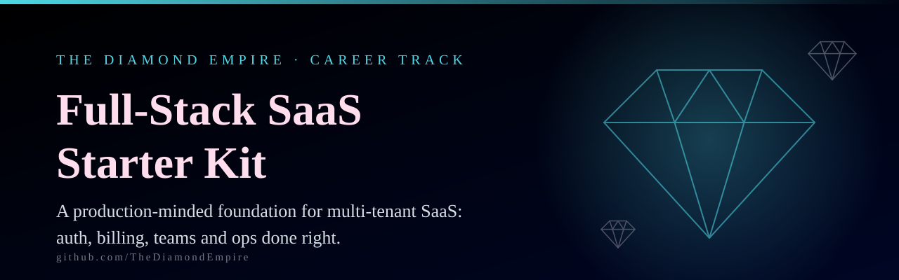

# Full-Stack SaaS Starter Kit: Client Case Study

> Reach first revenue sooner on a foundation that will not need to be rewritten.

> **Status of this document.** This is a reference case study: it sets out the business problem, the solution and the value model. The results table is intentionally blank and is filled in only from measured data (a pilot or a real engagement). No outcome figures are claimed here.

## Snapshot

|                   |                                                                                                             |
| ----------------- | ----------------------------------------------------------------------------------------------------------- |
| **Who it is for** | Founders and small product teams who need to reach a paying customer fast without piling up technical debt. |
| **Solution**      | A production-minded foundation for multi-tenant SaaS: auth, billing, teams and ops done right.              |
| **Track**         | Career · Advanced                                                                                           |
| **Delivered by** | The Diamond Empire |

## The challenge

Months go into login screens, billing edge cases and permissions before the first differentiating feature exists, and rushed versions of that plumbing cause revenue leaks and security incidents later.

## The solution

A reference implementation of the undifferentiated 80% of a SaaS product: authentication, organizations, role-based access, subscription billing, transactional email, audit logging and deployment, built to the same standard you would hold a paid product to.

What the client gets in practice (in the starter as shipped, billing runs on a Stripe simulator and email on a development mailer; connecting the client's own Stripe account and email provider is part of an engagement, see the [README](../README.md) for exactly what was and was not run):

- Email and OAuth sign-in, MFA and session management
- Organizations, invitations, roles and permissions with tenant isolation
- Stripe subscriptions with trials, plan changes, proration and idempotent webhook handling
- Usage metering and entitlement checks tied to plans
- API keys with scopes, rate limiting and an audit log

## How it creates value

| Value lever       | How the solution delivers it                                        | How we measure it                                             |
| ----------------- | ------------------------------------------------------------------- | ------------------------------------------------------------- |
| Time to market    | Reusable, tested foundations replace weeks of boilerplate           | Days from kickoff to first paying customer                    |
| Revenue integrity | Idempotent billing flows prevent double charges and missed upgrades | Billing discrepancies per month; failed-payment recovery rate |
| Risk              | Secure defaults and an audit log shorten security questionnaires    | Time to complete enterprise security review                   |
| Engineering focus | Team effort moves to the product’s unique value                     | Share of engineering time on core features                    |

## How an engagement runs

| Phase     | What happens                              |
| --------- | ----------------------------------------- |
| Plan      | Plans, roles and tenancy model            |
| Configure | Brand, billing and email                  |
| Extend    | First product feature on the foundation   |
| Launch    | Security checklist, load test and go-live |

## What the client receives

- Customized starter in the client’s repository
- Branded onboarding and billing plans
- Deployment pipeline and environments
- Architecture decision records
- Team walkthrough

## Results

Baseline measurements are taken **before** the solution goes live, and the same measures are taken after, so every change in the table is attributable and honest.

| Measure           | How measured                                                  | Baseline | After | Change |
| ----------------- | ------------------------------------------------------------- | -------- | ----- | ------ |
| Time to market    | Days from kickoff to first paying customer                    | —        | —     | —      |
| Revenue integrity | Billing discrepancies per month; failed-payment recovery rate | —        | —     | —      |
| Risk              | Time to complete enterprise security review                   | —        | —     | —      |
| Engineering focus | Share of engineering time on core features                    | —        | —     | —      |

> **To fill in:** replace each — with measured values and add the measurement window and sample size beneath the table.

## How quality and risk are managed

- End-to-end tests for the signup, subscribe, upgrade and cancel path
- Security checklist mapped to OWASP ASVS Level 1
- Automated dependency and secret scanning
- Documented architecture decision records for each major choice

## Is this a fit?

Best suited to: founders and small product teams who need to reach a paying customer fast without piling up technical debt.

## Talk to us

Want this adapted to your business? Get in touch via **[thedempire.shop](https://thedempire.shop/)**.

---

[README](../README.md) · [Client case study](case-study.md)
